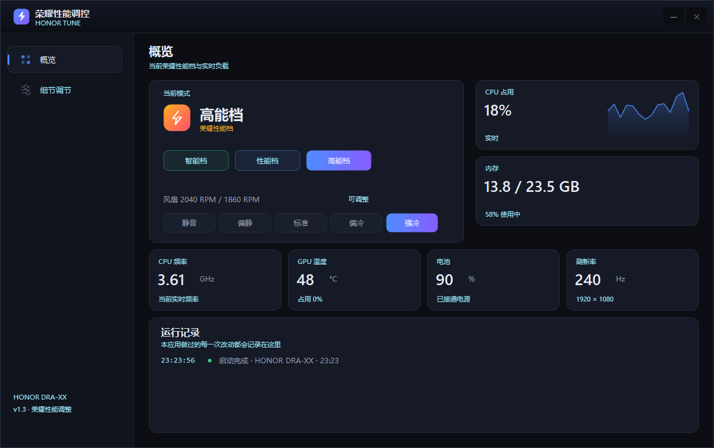
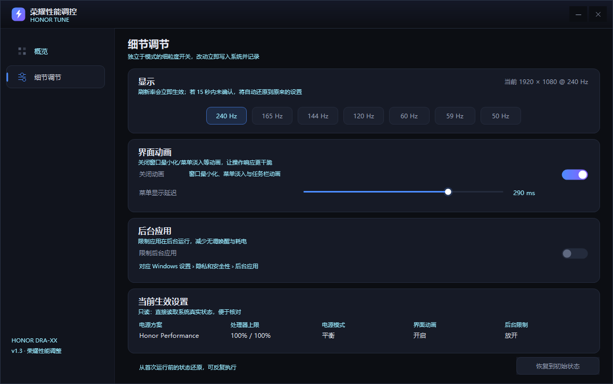

# Honor Tune

给💊笔记本用的性能调节桌面应用。单文件 WinForms，免安装、免运行库、不联网。

在 **HONOR MagicBook DRA-XX（DarwinA / Core Ultra 5 125H + RTX 4060）** 上开发并逐项实测。



---

## 一、它能做什么

### 档位（直接走 EC）

点一下切换💊自己的性能模式，和电脑管家是同一套接口：

| 档位 | 荣耀模式值 | 电源计划 |
|---|---|---|
| 智能档 | `0` | Windows 平衡 |
| 性能档 | `1` | Honor Performance |
| 高能档 | `3` | Honor Performance |

切换成功后会自动把 Windows 电源方案一起切过去，不用再去设置里手动改。

### 风扇转速（仅在 高能档 生效）

五个档位：静音 / 偏静 / 标准 / 偏冷 / 强冷。

这不是写注册表做样子——是真的下发到 EC。实测同样 8 核满载 40 秒：

| 档位 | 风扇转速 |
|---|---|
| 静音 | 2460 / 2220 RPM |
| 强冷 | 3060 / 2820 RPM |

**性能档下指令虽然返回成功，但风扇不跟随**，所以非高能档时按钮是禁用的。

### 实时监控

CPU 占用（带曲线）、内存、CPU 实时频率、GPU 温度、电池、刷新率，以及两颗风扇的实际转速。

> CPU 频率读的是 `Processor Information\Actual Frequency`，和任务管理器一致。
> 这颗混合架构 CPU 上 `Processor Frequency` 会一直显示 0.92 GHz，是错的。

### 细节调节

- **刷新率** —— 列出当前分辨率支持的全部刷新率，点了立即生效；**15 秒内不确认自动回滚**，防止改黑了没法救。
- **界面动画** —— 关闭最小化/菜单淡入/任务栏动画，可调菜单显示延迟 0–400 ms。
- **后台应用** —— 限制后台运行（对应「设置 › 隐私和安全性 › 后台应用」）。
- **当前生效设置** —— 只读，直接读系统真实值。
- **恢复到初始状态** —— 把改动全部还原。



---

## 二、怎么和💊的接口打通的

💊没有公开接口。这里的参数来自对已安装程序的静态分析和实测，不是猜的。

| 项目 | 实现 |
|---|---|
| 读💊模式 | WMI `root\wmi` → `OemWMIMethod::OemWMIfun`，输入 64 字节，`04 / 0E` |
| 写荣耀模式 | 同上，`04 / 0F`，第 3 字节为模式值，写完回读校验 |
| 读风扇转速 | 同上，`02 / 08`，第 3 字节为风扇序号，返回低字节在前 |
| 写风扇档位 | 同上，`07 / <input1> / <input2>` |
| 风扇参数 | 运行期解析 `config\FanSpeedConfig.dat`，按机型取 |

### 风扇参数是按机型读的，没有写死

`FanSpeedConfig.dat` 是「前 256 字节明文 + 加密段」的格式，每个字节都加了 `0x80`。减去 `0x80` 就能读到本机那一条：

```xml
<Product MachineType="DarwinA" input1="0x08">
  <Fan index="0" input2="0xAA"/>
  <Fan index="1" input2="0xAB"/>
  <Fan index="2" input2="0xAC"/>
  <Fan index="3" input2="0xAD"/>
  <Fan index="4" input2="0xAE"/>
```

机型名从 `HKLM\SOFTWARE\HONOR\PCManager\ProductName` 读，所以在别的💊机型上跑，取到的是那台机器自己的参数。

明文段可能正好截在最后一档中间（本机就是），这时若前四档是等差，会按同样步长补出第五档；补不出来或找不到机型时按钮直接禁用，不会乱发指令。

### Honor Performance 的 GUID

`b8a2c9f4-7d3e-4a1b-9c2f-5e8d6a3b1c4f` 不是本机随机生成的，它写死在 `PerfCommonPlugin.dll` 的 `HonorPowerPlan::EnterHighPerfMode` 里，各机型一致。

程序仍然按「先这个固定 GUID → 再按名字找 → 再试模板 GUID → 最后退 Windows 高性能」的顺序解析，免得某个机型上方案被改名或没建时切错。

### 其它

| 功能 | 实现 |
|---|---|
| 切换电源方案 | `PowerSetActiveScheme` |
| 刷新率 | `EnumDisplaySettings` 枚举 + `ChangeDisplaySettingsEx` |
| 界面动画 | HKCU `MinAnimate` / `MenuShowDelay` / `TaskbarAnimations` + `WM_SETTINGCHANGE` |
| 后台限制 | HKCU `BackgroundAccessApplications\GlobalUserDisabled` |
| GPU 温度 | `nvidia-smi` |

---

## 三、编译

不需要装 SDK，用系统自带的 .NET Framework 编译器：

```
build.cmd
```

或者手动：

```
%WINDIR%\Microsoft.NET\Framework64\v4.0.30319\csc.exe /codepage:65001 /target:winexe ^
  /win32icon:app.ico /out:HonorTune.exe HonorTune.cs ^
  /r:System.Windows.Forms.dll /r:System.Drawing.dll /r:System.Management.dll
```

C# 5 语法，任何 Windows 10/11 自带的 .NET Framework 4.x 都能跑。

---

## 四、运行

**不要**从带 Low 完整性标签的目录（例如某些沙箱工作区）直接启动，那样写不了 `%APPDATA%`，也建不了电源方案。复制到一般目录运行：

```
%LOCALAPPDATA%\Programs\HonorTune\HonorTune.exe
```

不需要管理员权限。

### 命令行

```
HonorTune.exe --apply eco|balanced|perf   切换 Windows 侧预设模式
HonorTune.exe --restore                   恢复到初始状态
HonorTune.exe --status                    打印当前状态
HonorTune.exe --refresh 120               改刷新率
HonorTune.exe --list-refresh              列出可用刷新率
HonorTune.exe --diag <输出文件>           环境诊断
```

---

## 五、已知限制

- 风扇档位只在**高能档**生效，这是硬件/固件行为，不是本程序的限制。
- 实时转速和温度依赖荣耀 WMI 接口，非荣耀机型上相关区域会显示 `—`。
- 温度只有 **GPU**；CPU 核心温度要读 MSR，本机 ACPI 热区读数不可信，已过滤。
- 刷新率以**主显示器**为准。
- 界面按 96 DPI 设计，高缩放下系统整体位图缩放，文字会略软。

## 六、说明

第三方工具，与荣耀官方无关。所有接口均为本机逆向分析与实测所得，换机型、换管家版本都可能失效。改动硬件性能模式与风扇转速有其固有风险，请自行判断使用。

代码以 MIT 协议发布。

## 七、致谢

本项目在 [DeepSeek](https://www.deepseek.com) 模型辅助下完成：荣耀 WMI 接口的定位、`PerfCommonPlugin.dll` 的反汇编分析、`FanSpeedConfig.dat` 的结构还原、界面实现与文档整理，均为与模型结对完成。
